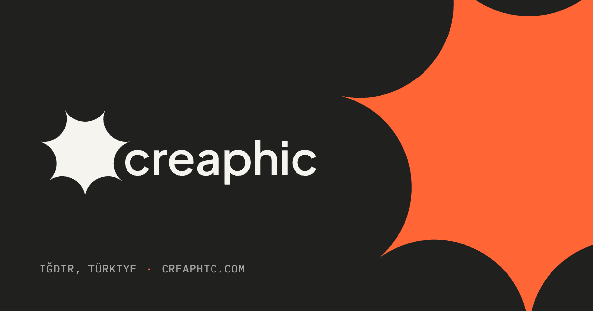
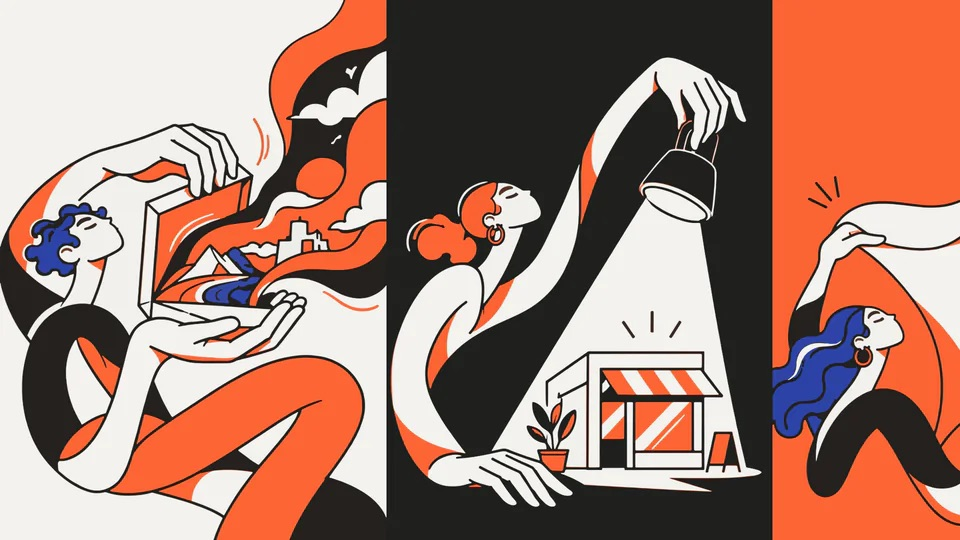
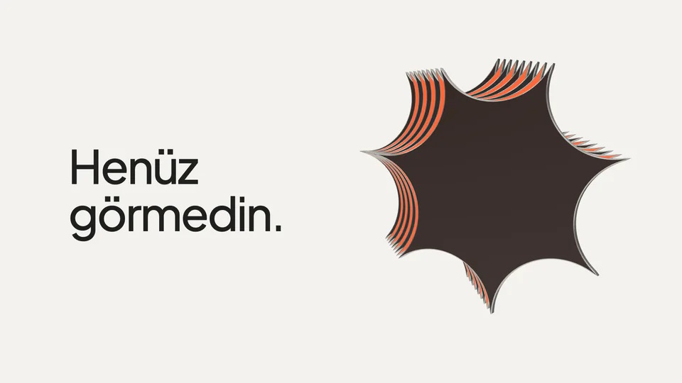
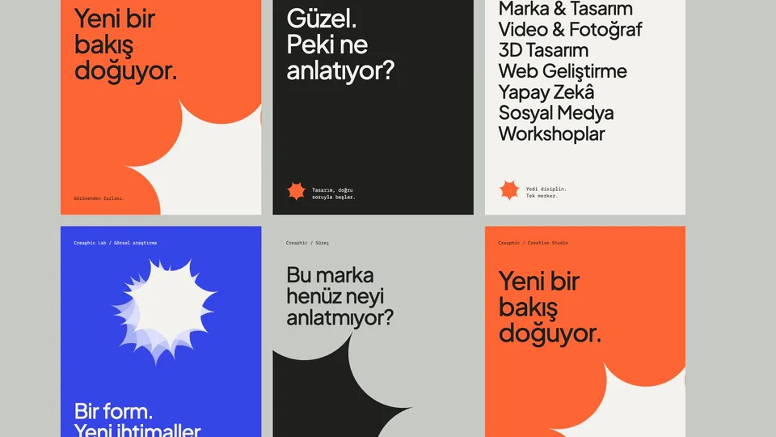
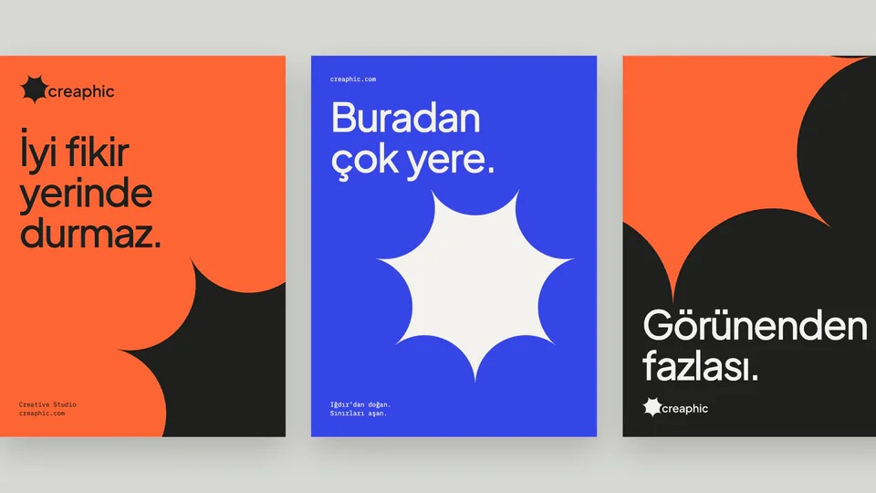

<b>English</b> · <a href="https://github.com/creaphic-studio/.github/blob/main/profile/README.tr.md">Türkçe</a>

  

<h1 align="center">Creaphic</h1>

<b>More than meets the eye.</b> 
A creative studio from Iğdır that makes the potential inside brands visible, through design, technology and motion.

  
  
  
  

  <a href="https://creaphic.com/en/work">Work</a> ·
  <a href="https://creaphic.com/en#services">Services</a> ·
  <a href="mailto:info@creaphic.com">Contact</a>

## Studio

Every brand has a side nobody has seen yet. We find it, give it form, and set it in motion.

**Find** the right question before the first answer. **Form** one idea with one dominant gesture, in type,
image, space and code. **Move** it across film, 3D, web and social: one character, many voices.

## Services

| | |
|---|---|
| **Brand & Design** | Logo and identity that look the same from signage to social. |
| **Video & Photography** | Brand films, ads and product shoots for Instagram, ads and the web. |
| **3D Design** | Modelling and animation that show a product before it exists. |
| **Web Development** | Fast, search-ready websites, designed and coded in-house. |
| **Artificial Intelligence** | AI-assisted content and automation; quality control stays human. |
| **Social Media** | Design, content plans and video for an account that stays recognisable. |
| **Workshops** | Brand and content workshops with your team. |

## Work

<table>
  <tr>
    <td width="33%"> <b>Creaphic Identity</b> Brand · More than meets the eye</td>
    <td width="33%"> <b>Character Language</b> Brand · There's more inside</td>
    <td width="33%"> <b>You Haven't Seen It</b> Film · A twenty-second teaser</td>
  </tr>
  <tr>
    <td width="33%"> <b>One Form</b> Lab · New possibilities</td>
    <td width="33%"> <b>Social System</b> Social · Same character, different voices</td>
    <td width="33%"> <b>Print & Stationery</b> Print · A signature, kept small</td>
  </tr>
</table>

<a href="https://creaphic.com/en/work">See all work →</a>

## Contact

Have a brand, a launch or a question? Write to **[info@creaphic.com](mailto:info@creaphic.com)**.
Studio in Iğdır, Türkiye, working with brands everywhere.
